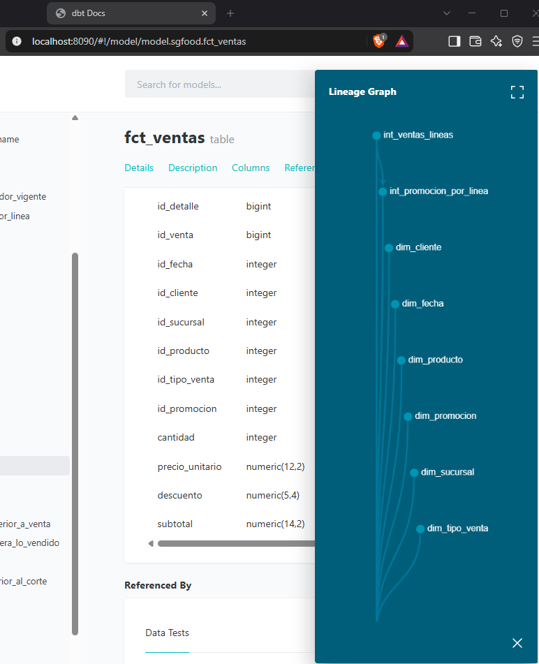

# Proyecto 1 · SG-Food: flujo ELT con Python, Airflow, dbt y PostgreSQL

Curso Seminario de Sistemas 2 · Semestre 2026-1 · Grupo 15

| Integrante | Usuario / carnet | Rol |
|---|---|---|
| Joel | 202201395 | A · Ingesta y orquestación (Python + Airflow) |
| Alvaro | 199817948 | B · Modelado y calidad (dbt + Data Warehouse) |

## 1. Descripción

SG-Food distribuye productos de varias marcas y categorías. Tenía procesos manuales, poca trazabilidad, ninguna prueba de calidad y dependía de la base transaccional para sus reportes. Este proyecto automatiza el flujo hacia un Data Warehouse en PostgreSQL:

- **Python** extrae la base transaccional y los CSV y los carga en el schema `raw`.
- **Apache Airflow** orquesta todo el flujo y las validaciones.
- **dbt Core** transforma `raw` en `staging`, `intermediate` y `marts` (modelo estrella), con pruebas y documentación.
- **PostgreSQL** aloja la fuente (`sgfood_oltp`) y el Data Warehouse (`sgfood_dw`).

## 2. Pipeline

```
sgfood_oltp (7 tablas) ─┐
                        ├─ Python ─→ raw ─→ dbt ─→ staging → intermediate → marts
data/csv (5 archivos) ──┘
```

DAG `sgfood_elt` (`airflow/dags/sgfood_elt.py`):

```
inicio → crear_schemas_raw → extraer_oltp ┐
                           → cargar_csv   ┴→ validar_raw → inyectar_casos_calidad
       → dbt_deps → dbt_build → validar_marts → fin
```

Detalle de scripts, validaciones, configuración del DAG y modo calidad: [docs/arquitectura_y_dag.md](docs/arquitectura_y_dag.md).


## 3. Data Warehouse y proyecto dbt

- `staging`: 12 vistas (una por tabla de `raw`).
- `intermediate`: 3 vistas (costo de proveedor vigente, líneas de venta, promoción por línea).
- `marts`: 7 dimensiones y 4 hechos con contratos, PK y FK.
- 73 pruebas de calidad; `dbt build` ejecuta 99 nodos en verde.

| Hecho | Grano | Filas |
|---|---|---|
| `fct_ventas` | línea de venta | 3,209 |
| `fct_inventario` | producto × sucursal × corte mensual | 3,840 |
| `fct_devoluciones` | devolución | 80 |
| `fct_metas_ventas` | sucursal × mes | 48 |

Dimensiones: `dim_fecha`, `dim_sucursal`, `dim_cliente`, `dim_proveedor`, `dim_producto`, `dim_promocion`, `dim_tipo_venta`.

Diagrama estrella, decisiones de diseño y lista de pruebas: [docs/modelo_dw_y_dbt.md](docs/modelo_dw_y_dbt.md).



## 4. Justificación de diseño

- **ELT con `raw` intacta:** el DW nunca consulta la base transaccional; todo entra a `raw` y dbt transforma.
- **Cargas idempotentes:** `TRUNCATE` + `INSERT` en una transacción; se puede repetir sin duplicar.
- **Staging sin filtros:** los datos inválidos llegan hasta las pruebas de calidad, que son las que los detectan.
- **Ventas ANULADA y PENDIENTE conservadas:** el estado vive en `dim_tipo_venta` y las consultas filtran COMPLETADA. Concilia con la fuente (838,452.07; COMPLETADA 780,201.72).
- **Costo vigente:** por producto, la fila de `fecha_vigencia` más reciente.
- **Promoción por línea:** si se solapan, gana la de mayor descuento.
- **Miembro -1 (DESCONOCIDO)** en cada dimensión: una venta sin cliente, producto o sucursal no se pierde.
- **dbt aislado de Airflow:** dbt vive en un entorno virtual aparte dentro de la imagen.

## 5. Estructura del repositorio

```
docker-compose.yml        PostgreSQL, Airflow y base de Airflow
Dockerfile.airflow        imagen de Airflow con dbt
.env.example              variables de conexión; copiar a .env
data/oltp/                fuente transaccional (sgfood_oltp.sql)
data/csv/                 fuentes CSV
data/calidad/             casos inválidos para la corrida de calidad
data/referencia/          diccionario de datos y .zip original
sql/                      01_raw_ddl.sql, 02_dw_ddl.sql, validacion/
extract_load/             scripts Python de extracción, carga y validación
airflow/dags/             DAG sgfood_elt
dbt/sgfood/               proyecto dbt (models, tests, macros)
docs/                     documentación técnica, enunciado y evidencias
```

## 6. Manual de implementación

Requisitos: Docker Desktop (o Docker Engine con Compose v2).

1. Configuración:

   ```bash
   cd Proyecto1
   cp .env.example .env
   ```

2. Levantar los contenedores (la primera vez construye la imagen de Airflow):

   ```bash
   docker compose up -d --build
   ```

3. Esperar a que `sgfood-airflow` esté `healthy` en `docker compose ps` y abrir http://localhost:8080 (no pide usuario).

4. El DAG `sgfood_elt` corre solo la primera vez. Para repetirlo:

   ```bash
   docker exec sgfood-airflow airflow dags trigger sgfood_elt
   ```

5. Corrida de calidad (los 10 casos inválidos; `dbt_build` debe fallar):

   ```bash
   docker exec sgfood-airflow airflow dags trigger sgfood_elt -c '{"modo_calidad": true}'
   ```

Si el puerto 5433 u 8080 está ocupado, cambiar `PG_HOST_PORT` o `AIRFLOW_HOST_PORT` en `.env`. Para empezar de cero: `docker compose down -v && docker compose up -d`.

### Ejecución manual sin Airflow (Python 3.10 a 3.13)

```bash
python3.12 -m venv .venv && source .venv/bin/activate
pip install -r extract_load/requirements.txt -r dbt/sgfood/requirements.txt
set -a && source .env && set +a
python extract_load/crear_raw.py
python extract_load/extract_oltp.py
python extract_load/load_csv.py
python extract_load/validate_raw.py
cd dbt/sgfood
dbt deps --profiles-dir .
dbt build --profiles-dir .
dbt docs generate --profiles-dir .
```

En Windows (PowerShell), cargar las variables con:
`Get-Content .env | Where-Object { $_ -match '^\w' } | ForEach-Object { $k, $v = $_ -split '=', 2; Set-Item "env:$k" $v }`

### Validación SQL

```bash
docker exec -i sgfood-postgres psql -U sgfood -d sgfood_dw < sql/validacion/20_consultas_analiticas.sql
docker exec -i sgfood-postgres psql -U sgfood -d sgfood_dw < sql/validacion/30_reconciliacion.sql
```

El DDL entregable del Data Warehouse está en `sql/02_dw_ddl.sql` (se ejecuta después de `sql/01_raw_ddl.sql`).

## 7. Evidencias

| Qué demuestra | Archivo |
|---|---|
| DAG en verde | `docs/evidencias/A_dag_grafo_verde.png` |
| Validación de `raw` | `docs/evidencias/A_log_validar_raw.png` |
| Reconciliación raw vs marts | `docs/evidencias/A_log_validar_marts.png` |
| Corrida de calidad (grafo, inyección, pruebas) | `docs/evidencias/A_calidad_*.png` |
| `dbt build` en verde | `docs/evidencias/B_dbt_build_verde.png` |
| Pruebas con datos inválidos | `docs/evidencias/B_tests_casos_invalidos.png` |
| Lineage de dbt | `docs/evidencias/B_lineage.png` |

## 8. Resultados de referencia

| Dato | Valor |
|---|---|
| Líneas de venta | 3,209 |
| Suma de subtotal (todas) | 838,452.07 |
| Suma de subtotal (COMPLETADA) | 780,201.72 |
| Suma de metas | 9,257,592.56 |