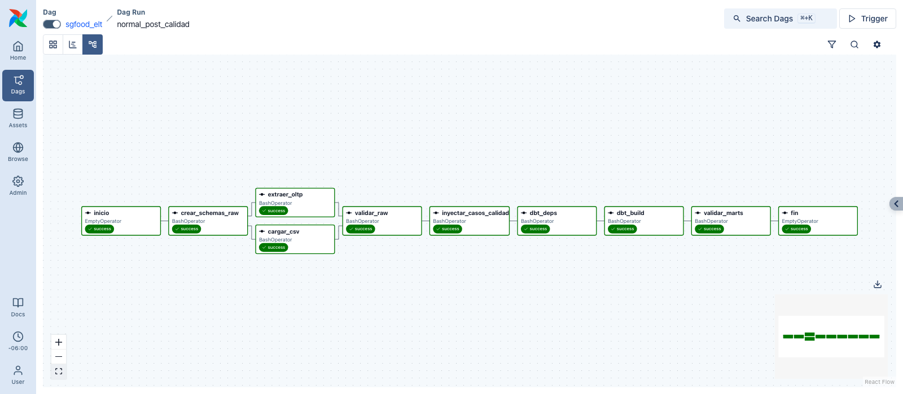
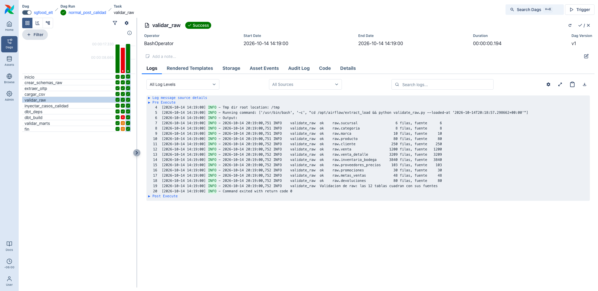
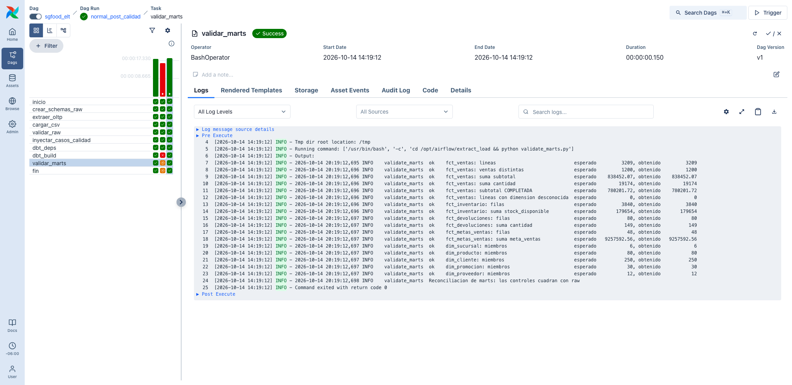
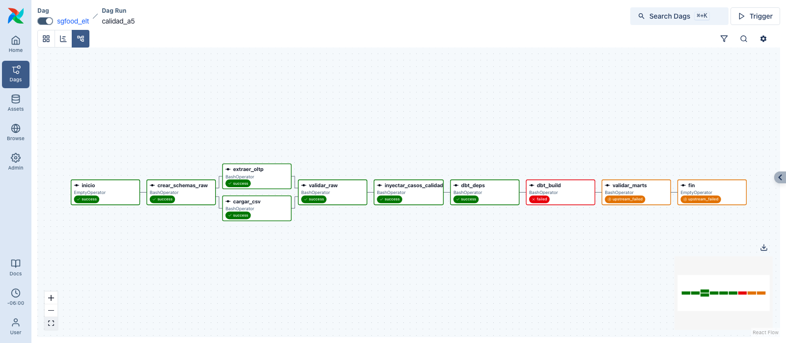
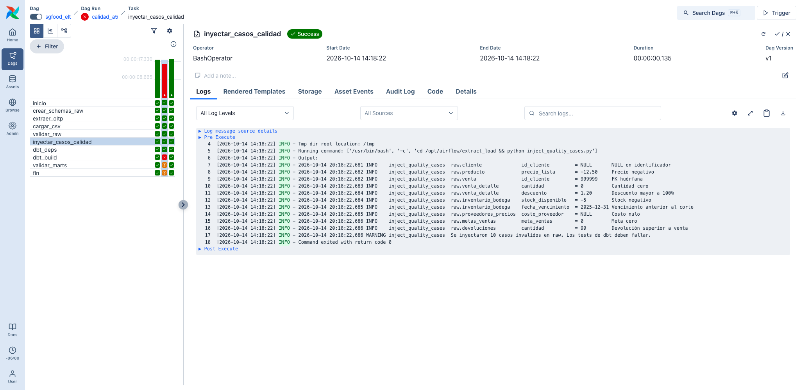
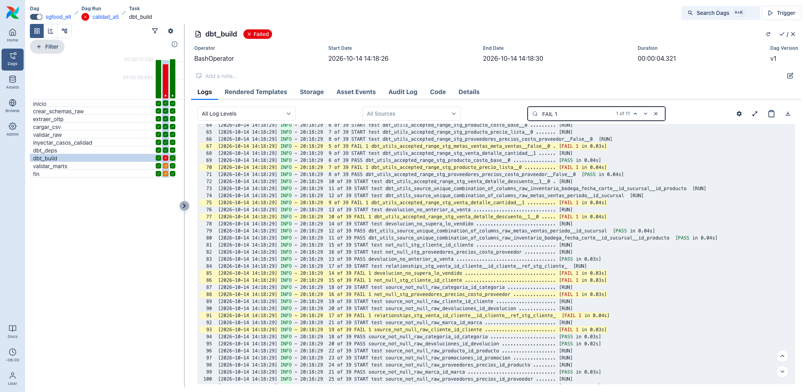

# Extracción, carga y orquestación con Airflow

Este documento explica cómo llegan los datos de SG-Food al Data Warehouse y cómo
Airflow coordina todo el flujo. Lo que pasa después de la capa `raw` (modelos dbt,
dimensiones y hechos) está en [modelo_dw_y_dbt.md](modelo_dw_y_dbt.md).

## Arquitectura

Todo corre con Docker Compose en tres contenedores:

- `sgfood-postgres` (PostgreSQL 16, puerto 5433). Tiene dos bases:
  - `sgfood_oltp`: la base transaccional de origen, cargada desde
    `data/oltp/sgfood_oltp.sql`.
  - `sgfood_dw`: el Data Warehouse, con los schemas `raw`, `staging`,
    `intermediate` y `marts`.
- `sgfood-airflow` (Airflow 3, puerto 8080). Ejecuta el DAG, los scripts de Python y
  dbt.
- `sgfood-airflow-db`: base interna de Airflow, separada del Data Warehouse.

El flujo es:

```
sgfood_oltp (7 tablas) ─┐
                        ├─ Python ─→ raw ─→ dbt ─→ staging → intermediate → marts
data/csv (5 archivos) ──┘
```

Por qué lo armamos así:

- El Data Warehouse nunca consulta la base transaccional directamente. Todo entra
  primero a `raw`, tal como viene de la fuente, y de ahí lo transforma dbt.
- Cada tarea del DAG llama a un script de Python. El mismo script se puede correr a
  mano desde la terminal, así que lo que probamos fuera de Airflow es lo mismo que
  corre dentro.
- Airflow guarda su historial en una base aparte, para que borrar el Data Warehouse
  no borre las corridas.

## Extracción y carga con Python

Los scripts están en `extract_load/`:

| Script | Qué hace |
|---|---|
| `crear_raw.py` | Crea las 12 tablas de `raw` con `sql/01_raw_ddl.sql` |
| `extract_oltp.py` | Copia las 7 tablas de la base transaccional a `raw` |
| `load_csv.py` | Carga los 5 archivos CSV a `raw` |
| `validate_raw.py` | Compara cuántas filas hay en la fuente y en `raw` |
| `validate_marts.py` | Compara conteos y totales de `raw` contra los marts |
| `inject_quality_cases.py` | Inserta datos inválidos para probar las pruebas de calidad |
| `config.py`, `contrato.py` | Conexiones y estructura esperada de cada tabla |

Cómo funciona la carga:

- Cada tabla de `raw` tiene las mismas columnas que su fuente, más dos de control:
  `_source` (de dónde vino la fila) y `_loaded_at` (cuándo se cargó).
- Cada corrida vacía las tablas y las vuelve a llenar dentro de una sola
  transacción. Si algo falla a mitad de camino, `raw` queda como estaba. Por eso se
  puede correr las veces que haga falta sin duplicar datos.
- La extracción de la base transaccional usa `COPY` de PostgreSQL, que mueve los
  datos en bloque.
- Los CSV vienen con BOM, así que se leen como `utf-8-sig`. Antes de cargar se
  revisa que el encabezado de cada archivo sea el esperado; si no lo es, la carga
  se detiene.
- Las conexiones se toman de variables de entorno (archivo `.env`), no están
  escritas en el código.
- Si algo falla, el script deja el error en el log y termina con código 1. Así
  Airflow marca la tarea como fallida.

## Validaciones

Hay dos validaciones propias, además de las pruebas de dbt:

1. `validar_raw`, después de la carga: revisa que las 12 tablas de `raw` tengan la
   misma cantidad de filas que su fuente y que todas sean de la corrida actual.
   Usa `sql/validacion/10_carga_raw.sql`.
2. `validar_marts`, después de dbt: compara `raw` contra los marts con
   `sql/validacion/30_reconciliacion.sql`. Revisa, por ejemplo, que `fct_ventas`
   tenga las 3,209 líneas y sume 838,452.07, igual que en `raw`, y que ninguna
   venta haya quedado sin cliente, producto o sucursal.

Si cualquiera de las dos encuentra una diferencia, la tarea falla y el log dice qué
no cuadró.

## DAG de Airflow

El DAG se llama `sgfood_elt` y está en `airflow/dags/sgfood_elt.py`:

```
inicio → crear_schemas_raw → extraer_oltp ┐
                           → cargar_csv   ┴→ validar_raw → inyectar_casos_calidad
       → dbt_deps → dbt_build → validar_marts → fin
```

| Tarea | Qué hace |
|---|---|
| `crear_schemas_raw` | Crea las tablas de `raw` si no existen |
| `extraer_oltp` y `cargar_csv` | Cargan la base y los CSV, en paralelo |
| `validar_raw` | Valida la carga |
| `inyectar_casos_calidad` | Solo hace algo si se activa el modo calidad |
| `dbt_deps` | Instala los paquetes de dbt |
| `dbt_build` | Construye los modelos y corre las pruebas de dbt |
| `validar_marts` | Reconcilia `raw` con los marts |

Configuración:

- Corre todos los días (`@daily`) y también se puede lanzar a mano.
- No recupera días pasados (`catchup=False`), porque cada corrida recarga todo.
- Solo una corrida a la vez, para que dos cargas no se pisen.
- Las tareas de conexión reintentan 2 veces, con 30 segundos de espera. Las
  validaciones y dbt no reintentan: si los datos están mal, reintentar no lo
  arregla.
- Cuando una tarea falla, una función (`registrar_fallo`) deja en el log qué tarea
  falló, en qué intento y el enlace a su log.

### Modo calidad

El enunciado incluye un archivo con 10 casos de datos inválidos
(`data/calidad/casos_calidad_opcionales.csv`). Para comprobar que las pruebas de
dbt los detectan, el DAG tiene el parámetro `modo_calidad`. Cuando se activa:

1. Después de la carga normal, `inyectar_casos_calidad` inserta los 10 casos en
   `raw`.
2. `dbt_build` construye staging e intermediate y luego corre las pruebas. Se hace
   en dos pasos porque con `dbt build` algunas pruebas se saltaban al fallar las
   anteriores, y así se prueban los 10 casos.
3. La tarea falla, como se espera, y el log muestra qué prueba atrapó cada caso.

La siguiente corrida normal vuelve a cargar `raw` desde las fuentes y elimina los
casos inválidos.

## Manual de implementación

Requisitos: Docker Desktop (o Docker Engine con Compose v2).

1. Entrar a la carpeta y crear el archivo de configuración:

   ```bash
   cd Proyecto1
   cp .env.example .env
   ```

2. Levantar los contenedores. La primera vez tarda unos minutos porque construye la
   imagen de Airflow:

   ```bash
   docker compose up -d --build
   ```

3. Esperar a que `docker compose ps` muestre `sgfood-airflow` como `healthy` y abrir
   http://localhost:8080. No pide usuario.

4. El DAG `sgfood_elt` aparece activo y corre solo la primera vez. Para correrlo de
   nuevo, usar el botón *Trigger* o:

   ```bash
   docker exec sgfood-airflow airflow dags trigger sgfood_elt
   ```

5. Para la corrida de calidad, usar *Trigger* con `{"modo_calidad": true}` o:

   ```bash
   docker exec sgfood-airflow airflow dags trigger sgfood_elt -c '{"modo_calidad": true}'
   ```

Si el puerto 5433 o el 8080 ya está ocupado, cambiar `PG_HOST_PORT` o
`AIRFLOW_HOST_PORT` en `.env`. Para empezar desde cero:
`docker compose down -v && docker compose up -d`.

Los scripts también se pueden correr sin Airflow (Python 3.10 a 3.13):

```bash
python3.12 -m venv .venv && source .venv/bin/activate
pip install -r extract_load/requirements.txt
python extract_load/crear_raw.py
python extract_load/extract_oltp.py
python extract_load/load_csv.py
python extract_load/validate_raw.py
```

## Evidencia de ejecución

Resultados de las pruebas:

- Carga: las 7 tablas de la base (6 sucursales, 8 categorías, 10 marcas,
  80 productos, 250 clientes, 1,200 ventas y 3,209 líneas de venta) y los 5 CSV
  (3,840 registros de inventario, 103 precios de proveedor, 30 promociones, 48 metas
  y 80 devoluciones) llegan completos a `raw`.
- Corrida desde cero: las 10 tareas en verde en unos 17 segundos. dbt construyó 26
  modelos y pasaron sus 73 pruebas.
- Dos corridas seguidas dan los mismos números, sin duplicar filas.
- Con PostgreSQL apagado, la tarea reintenta, falla y deja el error en el log; las
  tareas siguientes no corren.
- Al borrar una fila de `raw` o de los marts, la validación correspondiente falla y
  dice qué tabla no cuadra.
- En la corrida de calidad, los 10 casos inválidos son detectados por las pruebas
  de dbt.

Corrida normal con todas las tareas en verde:



Validación de la carga en `raw`:



Reconciliación de `raw` contra los marts:



Corrida de calidad: `dbt_build` falla y las tareas siguientes no corren.



Los 10 casos inválidos insertados:



Pruebas de dbt que detectaron los casos:


