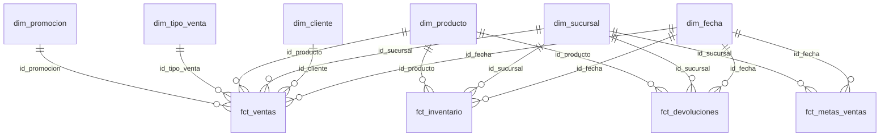
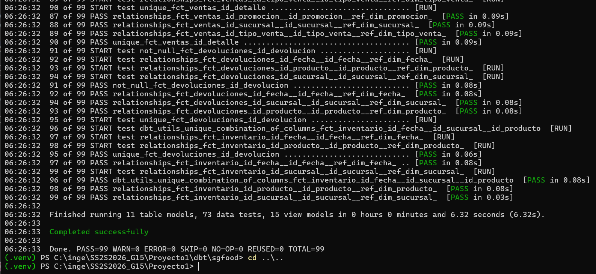
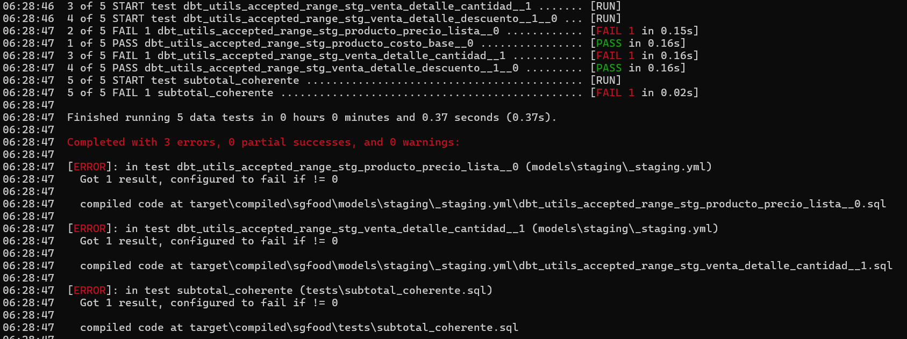

# Modelo del Data Warehouse y proyecto dbt

Este documento explica qué pasa con los datos después de que llegan a `raw`: cómo
los transforma dbt, cómo quedó el modelo dimensional, qué pruebas de calidad se
aplican y qué consultas se usan para validar. La extracción, la carga y el DAG están
en [arquitectura_y_dag.md](arquitectura_y_dag.md).

## Capas del Data Warehouse

dbt toma las 12 tablas de `raw` y construye tres capas, cada una en su propio schema
de `sgfood_dw`:

```
raw (12 tablas) → staging (12 vistas) → intermediate (3 vistas) → marts (7 dimensiones + 4 hechos)
```

| Capa | Materialización | Qué hace |
|---|---|---|
| `staging` | vista | Una vista por tabla de `raw`. Ajusta tipos, quita espacios y pasa los textos a mayúsculas. No elimina filas. |
| `intermediate` | vista | Reglas de negocio que se usan en varios modelos: costo vigente del proveedor, líneas de venta completas y promoción aplicada a cada línea. |
| `marts` | tabla | El modelo estrella, con llaves primarias y foráneas reales. |

Staging e intermediate son vistas porque no necesitan guardar datos y así siempre
reflejan lo que hay en `raw`. Los marts son tablas porque son los que se consultan.

## Estructura del proyecto dbt

```
dbt/sgfood/
  dbt_project.yml
  profiles.yml          conexión tomada de las variables DW_* del .env
  packages.yml          dbt_utils
  macros/               generate_schema_name: cada capa en su schema, sin prefijo
  models/
    staging/            _sources.yml, _staging.yml y 12 modelos stg_*
    intermediate/       3 modelos int_*
    marts/              _marts.yml, 7 dimensiones dim_* y 4 hechos fct_*
  tests/                4 pruebas propias en SQL
```

En total son 26 modelos y 73 pruebas.

## Modelo dimensional



`dim_proveedor` no se une directamente a un hecho. Se relaciona con el producto, que
guarda su proveedor vigente.

### Hechos

| Hecho | Una fila es | Filas | Medidas |
|---|---|---|---|
| `fct_ventas` | una línea de venta | 3,209 | cantidad, precio unitario, descuento, subtotal |
| `fct_inventario` | un producto en una sucursal en un corte mensual | 3,840 | stock disponible, mínimo y máximo; si está bajo el mínimo |
| `fct_devoluciones` | una devolución | 80 | cantidad |
| `fct_metas_ventas` | la meta de una sucursal en un mes | 48 | meta de ventas y de unidades |

### Dimensiones

| Dimensión | Filas | Contenido |
|---|---|---|
| `dim_fecha` | 1,828 | Calendario de 2024 a 2028 |
| `dim_sucursal` | 7 | 6 sucursales |
| `dim_cliente` | 251 | 250 clientes |
| `dim_proveedor` | 13 | 12 proveedores |
| `dim_producto` | 81 | 80 productos, con categoría, marca y costo del proveedor vigente |
| `dim_promocion` | 31 | 30 promociones |
| `dim_tipo_venta` | 49 | Las 48 combinaciones de canal, método de pago y estado |

Cada dimensión tiene una fila extra con llave -1 (DESCONOCIDO), explicada abajo.

## Decisiones de diseño

- **Se conservan todas las ventas.** `fct_ventas` incluye las ventas anuladas y
  pendientes, y el estado queda en `dim_tipo_venta`. Así el hecho cuadra con la
  fuente (838,452.07 en total), y las consultas de negocio filtran las completadas
  (780,201.72).
- **Costo del proveedor vigente.** 23 productos tienen más de un proveedor. Para
  cada producto se toma el precio con la fecha de vigencia más reciente.
- **Promoción de cada línea.** Algunas promociones se traslapan. A cada línea se le
  asigna la promoción de su categoría vigente ese día y, si hay varias, la de mayor
  descuento. 683 líneas tienen promoción.
- **Miembro desconocido (-1).** Si una venta no encuentra su cliente, producto o
  sucursal, se asigna a -1 en lugar de perderse. Con los datos actuales ninguna
  venta cae ahí, salvo las que no tienen promoción.
- **Staging no filtra.** Los datos inválidos llegan hasta las pruebas, que son las
  que los detectan, en lugar de desaparecer sin aviso.
- **Metas.** La suma de metas (9,257,592.56) es unas 11 veces lo vendido. Es el
  dato tal como viene en el archivo, no un error de carga.

## Pruebas de calidad

Con los datos limpios pasan las 73 pruebas:

| Dónde | Pruebas | Qué revisan |
|---|---|---|
| Fuentes (`raw`) | 22 | Llaves sin nulos ni repetidos |
| Staging | 13 | Rangos válidos (precios, cantidades, descuentos, stock, metas), valores permitidos y que cada venta tenga un cliente existente |
| Dimensiones | 14 | Llave primaria única y sin nulos |
| Hechos | 20 | Llaves únicas y que cada llave foránea exista en su dimensión |
| Pruebas propias | 4 | Reglas de negocio, ver abajo |

Pruebas propias, en `tests/`:

- El vencimiento de un lote no puede ser anterior a la fecha de corte.
- No se puede devolver más de lo que se vendió.
- El subtotal debe ser cantidad × precio × (1 − descuento).
- Una devolución no puede ser anterior a su venta.

Cada uno de los 10 casos de `casos_calidad_opcionales.csv` tiene una prueba que lo
detecta:

| Caso | Prueba que lo detecta |
|---|---|
| Cliente sin identificador | Llave no nula en clientes |
| Precio de lista negativo | Rango del precio de lista |
| Venta con un cliente que no existe | Relación venta → cliente |
| Cantidad cero | Rango de la cantidad |
| Descuento mayor a 100 % | Rango del descuento |
| Stock negativo | Rango del stock |
| Vencimiento anterior al corte | Prueba propia de vencimiento |
| Costo de proveedor nulo | Costo no nulo |
| Meta cero | Rango de la meta |
| Devolución mayor a lo vendido | Prueba propia de devoluciones |

La corrida del DAG con los 10 casos, con sus capturas, está en
[arquitectura_y_dag.md](arquitectura_y_dag.md#modo-calidad).

## Consultas analíticas

Están en `sql/validacion/20_consultas_analiticas.sql`, con el resultado esperado
escrito debajo de cada una. Todas cuentan solo ventas completadas.

1. Ventas reales contra la meta, por sucursal y mes.
2. Los 10 productos con más ingreso y los 10 con más margen.
3. Ingreso por canal y método de pago (suma 780,201.72).
4. Tasa de devolución por categoría y por motivo.
5. Productos bajo el stock mínimo en el último corte (50 casos).
6. Ventas con promoción contra ventas sin promoción, por categoría.

## DDL del Data Warehouse

`sql/02_dw_ddl.sql` crea los schemas, las dimensiones y los hechos con sus llaves
primarias y foráneas. Las tablas de `raw` están en `sql/01_raw_ddl.sql`, que se
ejecuta antes. Se probó en una base vacía y crea las mismas tablas que construye dbt.

## Cómo ejecutar esta parte

Con PostgreSQL levantado y `raw` cargada:

```bash
cd dbt/sgfood
dbt deps --profiles-dir .
dbt build --profiles-dir .
dbt docs generate --profiles-dir .
dbt docs serve --port 8090 --profiles-dir .
```

`dbt build` debe terminar con `ERROR=0`. Para correr las consultas analíticas:

```bash
docker exec -i sgfood-postgres psql -U sgfood -d sgfood_dw < sql/validacion/20_consultas_analiticas.sql
```

## Evidencias

`dbt build` en verde:



Pruebas fallando con datos inválidos:



Linaje de los modelos en `dbt docs`:


