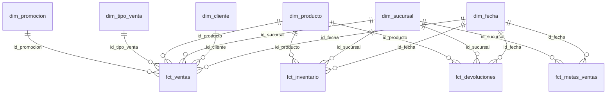

# Modelo del Data Warehouse y proyecto dbt

Proyecto 1 · SG-Food · Grupo 15. Responsable de esta parte: Alvaro (rol B, modelado y calidad).

Este documento describe todo lo que ocurre después del schema `raw`: modelos dbt, modelo dimensional, pruebas de calidad y consultas analíticas.

## 1. Visión general

Los datos crudos llegan a `sgfood_dw.raw` (cargados por Python, parte A). dbt los transforma en tres capas, cada una en su propio schema de PostgreSQL:

```
raw (12 tablas) ──► staging (12 vistas) ──► intermediate (3 vistas) ──► marts (7 dimensiones + 4 hechos)
```

| Capa | Schema | Materialización | Contenido |
|---|---|---|---|
| Staging | `staging` | view | Un `stg_*` por tabla de `raw`: tipos explícitos, `trim`, textos normalizados en mayúsculas, sin filtrar filas |
| Intermediate | `intermediate` | view | Reglas de negocio reutilizables: costo vigente, líneas de venta enriquecidas, promoción por línea |
| Marts | `marts` | table | Modelo dimensional (estrella) con contratos, PK y FK reales |

La macro `macros/generate_schema_name.sql` hace que cada carpeta construya en el schema de su mismo nombre, sin prefijo (por ejemplo `marts.fct_ventas`).

## 2. Estructura del proyecto dbt

```
dbt/sgfood/
  dbt_project.yml
  profiles.yml                 conexión por variables de entorno DW_*
  packages.yml                 dbt_utils
  macros/generate_schema_name.sql
  models/
    staging/    _sources.yml, _staging.yml, stg_*.sql (12)
    intermediate/  int_costo_proveedor_vigente, int_ventas_lineas, int_promocion_por_linea
    marts/      _marts.yml, dim_* (7), fct_* (4)
  tests/        4 tests singulares
```

Totales: 26 modelos (12 + 3 + 11), 12 sources y 73 tests. Un `dbt build` completo ejecuta 99 nodos.

## 3. Modelo dimensional

### 3.1 Diagrama estrella



`dim_proveedor` no se enlaza a ningún hecho: se relaciona con `dim_producto` por `id_proveedor_vigente` (atributo del producto, sin FK declarada).

### 3.2 Tablas de hechos

| Hecho | Grano | Filas | Llave | Medidas |
|---|---|---|---|---|
| `fct_ventas` | una línea de venta | 3,209 | PK `id_detalle` | cantidad, precio_unitario, descuento, subtotal |
| `fct_inventario` | producto × sucursal × corte mensual | 3,840 | compuesta (fecha, sucursal, producto) | stock_disponible, stock_minimo, stock_maximo, bajo_stock_minimo |
| `fct_devoluciones` | un registro de devolución | 80 | PK `id_devolucion` | cantidad |
| `fct_metas_ventas` | sucursal × mes | 48 | compuesta (fecha, sucursal) | meta_ventas, meta_unidades |

### 3.3 Dimensiones

| Dimensión | Filas | Notas |
|---|---|---|
| `dim_fecha` | 1,828 | Calendario 2024-01-01 a 2028-12-31 (1,827 días + miembro -1). `id_fecha` en formato YYYYMMDD |
| `dim_sucursal` | 7 | 6 sucursales + -1 |
| `dim_cliente` | 251 | 250 clientes + -1 |
| `dim_proveedor` | 13 | 12 proveedores + -1 |
| `dim_producto` | 81 | 80 productos + -1. Incluye categoría, marca y costo de proveedor vigente |
| `dim_promocion` | 31 | 30 promociones + -1 (SIN PROMOCION) |
| `dim_tipo_venta` | 49 | Dimensión basura: 4 canales × 4 métodos de pago × 3 estados = 48, + -1 |

## 4. Decisiones de diseño

**Estado de la venta.** `fct_ventas` conserva las 3,209 líneas, incluidas las ANULADA y PENDIENTE (1,129 ventas COMPLETADA, 48 ANULADA, 23 PENDIENTE). El estado vive en `dim_tipo_venta` y las consultas filtran `estado = 'COMPLETADA'`. Así el hecho concilia contra la fuente (suma de subtotal 838,452.07) y el filtro de negocio queda explícito en cada consulta (COMPLETADA: 780,201.72).

**Costo de proveedor vigente.** 23 productos tienen más de un proveedor. `int_costo_proveedor_vigente` toma, por producto, la fila con `fecha_vigencia` más reciente. El desempate (menor costo, luego menor `id_proveedor`) es una red de seguridad: se comprobó que no hay empates de fecha. Resultado: exactamente 80 filas, una por producto.

**Promoción por línea.** Las promociones se solapan (7 pares de la misma categoría). `int_promocion_por_linea` asigna a cada línea la promoción de su categoría vigente en la fecha de venta; si hay varias, gana la de mayor `porcentaje_descuento` y, en empate, la de menor `id_promocion`. Devuelve una fila por línea (3,209), de las cuales 683 tienen promoción.

**Miembro -1.** Cada dimensión incluye un miembro -1 DESCONOCIDO. Las FK de los hechos usan `coalesce(..., -1)` para que un join fallido nunca elimine filas. Con los datos limpios ninguna FK cae en -1 (salvo `id_promocion`, que es -1 cuando la línea no tiene promoción).

**dim_tipo_venta completa.** Se genera con el producto cruzado de todos los valores posibles (48 combinaciones) y no solo las 41 observadas, para que una venta futura con una combinación nueva no quede sin llave.

**dim_fecha amplia.** Cubre desde 2024-01-01 (primera alta de cliente) hasta 2028-12-31 (el vencimiento máximo de inventario es 2028-01-13). La fecha de vencimiento se deja además como atributo de `fct_inventario`.

**Metas de ventas.** `fct_metas_ventas` usa el primer día del mes como fecha. La suma de metas (9,257,592.56) es unas 11 veces lo vendido (838,452.07). No es un error de carga: es el dato tal como llegó, y se documenta en la consulta analítica 1.

**Materializaciones.** Staging e intermediate son vistas (no duplican datos y siempre reflejan `raw`); marts son tablas con contrato (`contract: enforced`), para que los tipos y las restricciones sean estables.

**Staging sin filtros.** Los `stg_*` no eliminan filas, para que los tests de calidad puedan detectar los datos inválidos en lugar de que desaparezcan antes.

## 5. Restricciones y contratos

Todas las dimensiones y hechos de `marts` declaran `contract: enforced` con el tipo de cada columna.

- Las 7 dimensiones tienen PK sobre su `id_*`.
- `fct_ventas` (PK `id_detalle`) y `fct_devoluciones` (PK `id_devolucion`) tienen PK; `fct_ventas` además tiene 6 FK, y los demás hechos tienen FK hacia sus dimensiones.
- `fct_inventario` y `fct_metas_ventas` tienen llave compuesta. dbt la valida con `dbt_utils.unique_combination_of_columns`. El DDL entregable (`sql/02_dw_ddl.sql`) la declara como PK compuesta.

Nota sobre nombres: dbt-postgres construye cada tabla como `<tabla>__dbt_tmp` y luego la renombra, pero los índices y constraints conservan el nombre temporal (por ejemplo `fct_ventas__dbt_tmp_pkey`). La estructura es la correcta. `sql/02_dw_ddl.sql` declara los mismos objetos con nombres limpios.

## 6. Pruebas de calidad

Total: 73 tests, todos en verde con datos limpios (`dbt build`: PASS=99, ERROR=0).

| Grupo | Cantidad | Qué valida |
|---|---|---|
| Sources (`_sources.yml`) | 22 | unique y not_null en las llaves de las 12 tablas de `raw`; combinación única en `inventario_bodega` y `metas_ventas` |
| Staging (`_staging.yml`) | 13 | rangos (precio, costo, cantidad, descuento, stock, metas), valores aceptados de canal, método de pago y estado, relación venta → cliente, not_null |
| Dimensiones (`_marts.yml`) | 14 | unique y not_null de cada PK |
| Hechos (`_marts.yml`) | 20 | PK, combinaciones únicas y `relationships` de cada FK hacia su dimensión |
| Singulares (`tests/`) | 4 | ver abajo |

Tests singulares:

| Archivo | Regla |
|---|---|
| `vencimiento_posterior_al_corte.sql` | `fecha_vencimiento` no puede ser anterior a `fecha_corte` |
| `devolucion_no_supera_lo_vendido.sql` | lo devuelto por venta y producto no supera lo vendido |
| `subtotal_coherente.sql` | subtotal = cantidad × precio × (1 − descuento), tolerancia 0.01 |
| `devolucion_no_anterior_a_venta.sql` | la devolución no es anterior a la venta |

### 6.1 Cobertura de los 10 casos de `casos_calidad_opcionales.csv`

| Caso | Test que lo atrapa |
|---|---|
| NULL en id_cliente | `not_null` en `stg_cliente.id_cliente` |
| precio_lista negativo | `accepted_range` ≥ 0 en `stg_producto.precio_lista` |
| FK huérfana en venta | `relationships` `stg_venta.id_cliente` → `stg_cliente` |
| cantidad cero | `accepted_range` ≥ 1 en `stg_venta_detalle.cantidad` |
| descuento > 100 % | `accepted_range` 0 a 1 en `stg_venta_detalle.descuento` |
| stock negativo | `accepted_range` ≥ 0 en `stg_inventario_bodega.stock_disponible` |
| vencimiento anterior al corte | singular `vencimiento_posterior_al_corte` |
| costo de proveedor nulo | `not_null` y rango > 0 en `stg_proveedores_precios.costo_proveedor` |
| meta cero | `accepted_range` > 0 en `stg_metas_ventas.meta_ventas` |
| devolución mayor a lo vendido | singular `devolucion_no_supera_lo_vendido` |

Verificación manual realizada: se modificó en `raw` un `precio_lista` a -5 y una `cantidad` a 0. Fallaron `accepted_range` de `precio_lista` y de `cantidad`, y también `subtotal_coherente` (el subtotal original ya no coincide con cantidad 0). Después se recargó `raw` y el build volvió a verde. La captura está en `docs/evidencias/B_tests_casos_invalidos.png`. La corrida completa de los 10 casos con el modo calidad del DAG corresponde a la parte A (A5).

## 7. Consultas analíticas

Están en `sql/validacion/20_consultas_analiticas.sql`, con el resultado anotado bajo cada una. Todas las medidas de venta usan solo estado COMPLETADA.

1. Ventas reales vs meta por sucursal y mes (48 filas; cumplimiento entre 3.39 % y 16.62 %).
2. Top 10 de productos por ingreso y por margen (precio frente a costo de proveedor vigente).
3. Ingreso por canal y método de pago (16 filas; suman 780,201.72).
4. Tasa de devolución por categoría y por motivo (unidades devueltas / vendidas).
5. Productos bajo el stock mínimo por sucursal en el último corte (2026-08-31; 50 en total).
6. Ventas con promoción vs sin promoción por categoría.

Observaciones: la tasa de devolución (consulta 4) no filtra las devoluciones por el estado de la venta original, y el hallazgo de inventario bajo el mínimo es un resultado de negocio, no un fallo de calidad.

## 8. DDL entregable

`sql/02_dw_ddl.sql` crea los schemas, las 7 dimensiones y los 4 hechos con PK y FK de nombre limpio. Las tablas de `raw` están en `sql/01_raw_ddl.sql` y debe ejecutarse antes. Se comprobó en una base vacía: corre sin errores, es idempotente (se ejecutó dos veces) y deja 23 tablas (12 de `raw` y 11 de `marts`).

## 9. Cómo reproducir esta parte

Con PostgreSQL arriba y `raw` cargada (ver `docs/arquitectura_y_dag.md`):

```bash
cd dbt/sgfood
dbt deps --profiles-dir .
dbt build --profiles-dir .          # 99 nodos, debe terminar con ERROR=0
dbt docs generate --profiles-dir .
dbt docs serve --port 8090 --profiles-dir .
```

Las consultas de validación se ejecutan con:

```bash
docker exec -i sgfood-postgres psql -U sgfood -d sgfood_dw < sql/validacion/20_consultas_analiticas.sql
```

Evidencias en `docs/evidencias/`: `B_dbt_build_verde.png`, `B_tests_casos_invalidos.png` y `B_lineage.png`.