# Proyecto 2 · Análisis de datos masivos en BigQuery

Seminario de Sistemas 2 · Grupo 15

| Integrante | Carnet |
|---|---|
| Joel | 202201395 |
| Alvaro | 199817948 |

## Dataset

Usamos `bigquery-public-data.new_york_taxi_trips.tlc_yellow_trips_2022`, con los viajes de taxi amarillo de Nueva York en 2022. Tiene 36,256,539 registros con fechas, distancia, pasajeros, zonas de origen y destino, tipo de pago y montos. Para los nombres de las zonas usamos `taxi_zone_geom`, del mismo dataset.

Al explorarlo encontramos:

- 1,241,840 viajes sin pasajeros, tipo de tarifa ni tipo de pago.
- Viajes con distancia, tarifa o duración en cero o negativas, y fechas desde 2001 hasta 2023.
- No hay datos de diciembre: el año termina el 30 de noviembre.
- El 17 y 18 de septiembre están incompletos en la fuente.

Todo corre en el proyecto `ss2-g15-nyc-taxi`, dataset `nyc_taxi_g15`, en la región US.

## Scripts

| Script | Qué hace |
|---|---|
| `sql/00_viajes_limpios.sql` | Crea la tabla limpia que usa todo el proyecto |
| `sql/01_exploracion.sql` | Exploración: estructura, volumen, calidad, distribuciones y patrones |
| `sql/02_transformaciones.sql` | Tablas resumidas para el tablero |
| `sql/03_optimizacion.sql` | Comparación de consultas estándar contra optimizadas |
| `ml/` | Modelos de BigQuery ML |

Se corren en ese orden. El de optimización se corre con la caché desactivada.

## Transformaciones

`viajes_limpios` deja fuera los viajes con fechas fuera de rango, duración menor a 1 minuto o mayor a 3 horas, distancia en cero o mayor a 100 millas, tarifa menor a 2.50 USD, pasajeros en cero o más de 6, y códigos o zonas desconocidas. Quedan **32,875,149 viajes**, el 90.67 % del total.

Le agregamos estas columnas:

- **Fecha y hora:** mes, día de la semana, fin de semana, hora y franja horaria.
- **Viaje:** duración en minutos y velocidad promedio.
- **Pago:** tipo de pago y de tarifa en texto, y la propina como porcentaje de la tarifa (solo con tarjeta, porque la propina en efectivo no se registra).
- **Ubicación:** nombre de zona y distrito de origen y destino, y si el viaje es de aeropuerto.

Para el tablero creamos tablas resumidas: viajes por día (`a_resumen_diario`), por día y hora (`a_demanda_hora_dia`), por zona (`a_zonas_origen`), por tipo de pago y mes (`a_pagos_mes`) y entre distritos (`a_flujos_borough`).

## Optimización

`viajes_limpios` está **particionada por fecha** y tiene **clustering por zona de origen y destino**. Elegimos esas columnas porque casi todas las consultas filtran por un periodo y muchas por una zona.

Para medir la mejora corrimos las mismas consultas en tres tablas:

- la pública, que es la consulta estándar;
- una copia de `viajes_limpios` sin particiones ni clustering;
- `viajes_limpios`, la optimizada.

| Consulta | Pública | Sin optimizar | Optimizada | Reducción |
|---|---:|---:|---:|---:|
| Una semana de marzo | 829.85 MB | 501.63 MB | 11.29 MB | 97.75 % |
| Salidas de JFK en marzo | 1,162.18 MB | 803.06 MB | 71.31 MB | 91.12 % |
| Una zona en todo el año | 996.84 MB | 653.13 MB | 577.17 MB | 11.63 % |
| Sin filtros | 829.85 MB | 501.63 MB | 501.63 MB | 0 % |

La reducción se calcula contra la copia sin optimizar, que tiene los mismos datos.

- **La partición es la que más ahorra:** al filtrar una semana, BigQuery solo lee 7 de los 334 días.
- **El clustering ayuda cuando se combina con la fecha.** Si se filtra solo por zona, igual tiene que abrir todos los días, y el ahorro es pequeño.
- **Sin filtros no hay ahorro**, como se esperaba.
- **El tiempo también baja:** la consulta de una semana pasó de 354 a 176 ms.

## Hallazgos

- **La hora pico es a las 6 de la tarde, de martes a jueves**, con unos 7,700 viajes por hora. La más baja es las 3 de la mañana, con unos 200.
- **El tráfico casi duplica la duración de un viaje.** La velocidad promedio baja a 9.2 mph un jueves a las 4 de la tarde y sube a 23.6 mph un domingo a las 6 de la mañana.
- **Enero es el mes con menos viajes**, con 2.25 millones. Marzo y octubre son los de más, con 3.31 millones cada uno.
- **El 91 % de los viajes sale de Manhattan**, y el 85 % empieza y termina ahí.
- **Los viajes de aeropuerto son el 10 % del total pero dejan el 27 % del ingreso:** en promedio cuestan 56.77 USD, contra 16.75 del resto.
- **El 80 % paga con tarjeta**, y la propina típica es del 26 % de la tarifa.

## Modelos de BigQuery ML

## Modelos de BigQuery ML

Se entrenaron dos tipos de modelo para estimar la **tarifa del viaje (`fare_amount`)** con datos conocidos al pedir el taxi: una regresión lineal como línea base y un árbol con boosting. Cada uno se probó con dos configuraciones de hiperparámetros. Los scripts están en `ml/`: `01_features.sql`, `02_modelos.sql`, `03_evaluacion.sql` y `04_predicciones.sql`.

### Variables

| Rol | Variables | Por qué |
|---|---|---|
| **Objetivo (salida)** | `fare_amount` | Es la tarifa que se quiere estimar. |
| **Entrada** | `trip_distance`, `passenger_count`, `hora`, `dia_semana`, `es_fin_de_semana`, `pickup_location_id`, `dropoff_location_id`, `pickup_borough`, `dropoff_borough`, `tipo_tarifa`, `es_aeropuerto` | La distancia y la zona definen la tarifa base. La hora y el día capturan la demanda, y el aeropuerto cambia mucho el precio (56.77 USD en promedio contra 16.75 del resto). |
| **Derivadas** | `es_hora_pico` (entre semana de 4 a 7 de la tarde), `es_mismo_borough` | La hora pico es el momento de mayor demanda y de tráfico lento. `es_mismo_borough` separa los viajes dentro de un distrito de los que cruzan entre distritos. |

`trip_distance` se usa como la distancia estimada de la ruta al pedir el taxi.

**Variables excluidas por data leakage:** `total_amount`, `tip_amount`, `tolls_amount`, `extra`, `mta_tax`, `imp_surcharge`, `airport_fee` y `propina_pct`, porque contienen la tarifa o se conocen hasta el final del viaje. También `dropoff_datetime`, `duracion_min` y `velocidad_mph`, que solo se saben al llegar.

### Datos y split

Se entrena sobre `b_viajes_ml`, una muestra reproducible (por hash, sin `RAND()`) de cerca del 5 % de `viajes_limpios`: **1,643,118 filas**.

| Conjunto | Periodo | Filas | Uso |
|---|---|---|---|
| Entrenamiento | enero a agosto | 1,187,144 | Entrenar |
| Evaluación | septiembre y octubre | 308,983 | Evaluar |
| Nuevos | noviembre | 146,991 | Predicciones; no se usó al entrenar ni al evaluar |

Se usó un **split temporal personalizado** (`data_split_method = 'CUSTOM'` con la columna `es_evaluacion`). Así el modelo se evalúa con meses que nunca vio, como pasaría en la realidad. El dataset no tiene diciembre, por eso noviembre es el conjunto de datos nuevos, y el 17 y 18 de septiembre están incompletos en la fuente.

Para comparar, se entrenó también una versión con **split aleatorio** (`data_split_method = 'RANDOM'` y `data_split_eval_fraction = 0.2`).

### Modelos e hiperparámetros

| Modelo | Tipo | Hiperparámetros | Split |
|---|---|---|---|
| `modelo_lineal_v1` | `LINEAR_REG` | `l2_reg = 0`, `max_iterations = 20` | Temporal |
| `modelo_lineal_v2` | `LINEAR_REG` | `l2_reg = 1`, `max_iterations = 20` | Temporal |
| `modelo_arbol_v1` | `BOOSTED_TREE_REGRESSOR` | `max_iterations = 50`, `learn_rate = 0.1`, `max_tree_depth = 6`, `subsample = 0.8` | Temporal |
| `modelo_arbol_v2` | `BOOSTED_TREE_REGRESSOR` | `max_iterations = 50`, `learn_rate = 0.2`, `max_tree_depth = 8`, `subsample = 0.8` | Temporal |
| `modelo_arbol_v2_random` | `BOOSTED_TREE_REGRESSOR` | Igual que `modelo_arbol_v2` | Aleatorio 20 % |

### Resultados

Métricas sobre el conjunto de evaluación de cada modelo (MAE y RMSE en USD):

| Modelo | MAE | RMSE | R² |
|---|---:|---:|---:|
| `modelo_lineal_v1` | 2.16 | 72.35 | -32.98 |
| `modelo_lineal_v2` | 1.90 | 3.26 | 0.931 |
| `modelo_arbol_v1` | 1.62 | 2.85 | 0.947 |
| `modelo_arbol_v2` | **1.49** | **2.66** | **0.954** |
| `modelo_arbol_v2_random` (evaluación aleatoria) | 1.27 | 2.13 | 0.967 |

- **El lineal v1 falló por unos pocos viajes.** Cuatro predicciones salieron entre -18,000 y -25,000 USD, todas con salida en zonas poco frecuentes (222, 19 y 46). Con regularización L2 (`l2_reg = 1`) el RMSE bajó de 72.35 a 3.26, lo que apunta a coeficientes inestables en zonas con pocos viajes de entrenamiento.
- **El árbol supera al lineal**, y la configuración v2 (árboles más profundos y `learn_rate` mayor) mejora a la v1 en las tres métricas.
- **El split aleatorio da métricas optimistas.** Se evaluaron ambos árboles sobre noviembre, que ninguno vio:

| Modelo | MAE | RMSE | R² |
|---|---:|---:|---:|
| `modelo_arbol_v2` (split temporal) | 1.447 | 2.418 | 0.960 |
| `modelo_arbol_v2_random` (split aleatorio) | 1.446 | 2.405 | 0.960 |

  En noviembre los dos rinden casi igual, pero el split aleatorio prometía un error cerca de 12 % menor (1.27) que el real (1.45), porque mezcla en entrenamiento y evaluación viajes del mismo periodo. El temporal estimó 1.49, mucho más cerca de lo que pasó en datos nuevos.

**Modelo elegido: `modelo_arbol_v2` con split temporal.** Tiene el mejor MAE, RMSE y R² en la evaluación temporal, y en noviembre su MAE (1.447) es menor que el del lineal v2 (1.861).

### Predicciones sobre registros nuevos

`ml/04_predicciones.sql` genera la tabla `b_predicciones` con las **146,991 predicciones de noviembre**, tarifa real y predicha por `modelo_lineal_v2` y `modelo_arbol_v2`. Error absoluto medio en noviembre: 1.861 USD el lineal y 1.447 USD el árbol.

### Evidencias de los modelos

Los cinco modelos creados en BigQuery:

Filas por conjunto en `b_viajes_ml`:

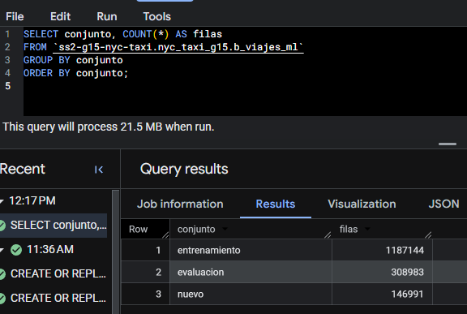

Comparación de métricas de los cinco modelos:

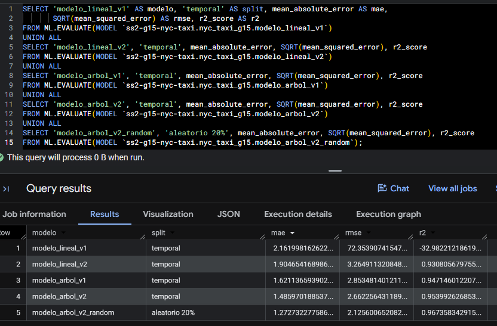

Los 20 mayores errores de `modelo_lineal_v1`, con predicciones absurdas en zonas poco frecuentes:

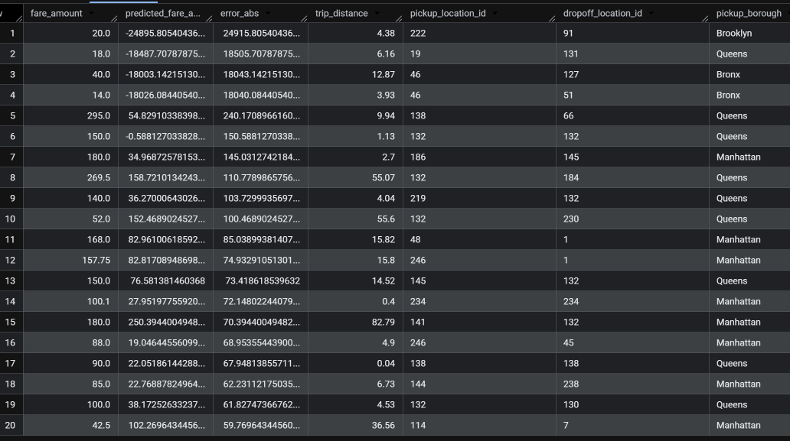

Los dos árboles evaluados sobre noviembre:

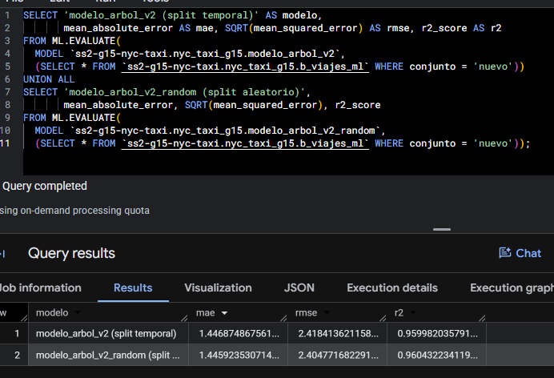

Iteraciones de entrenamiento (`ML.TRAINING_INFO`) del árbol v1 y del v2:

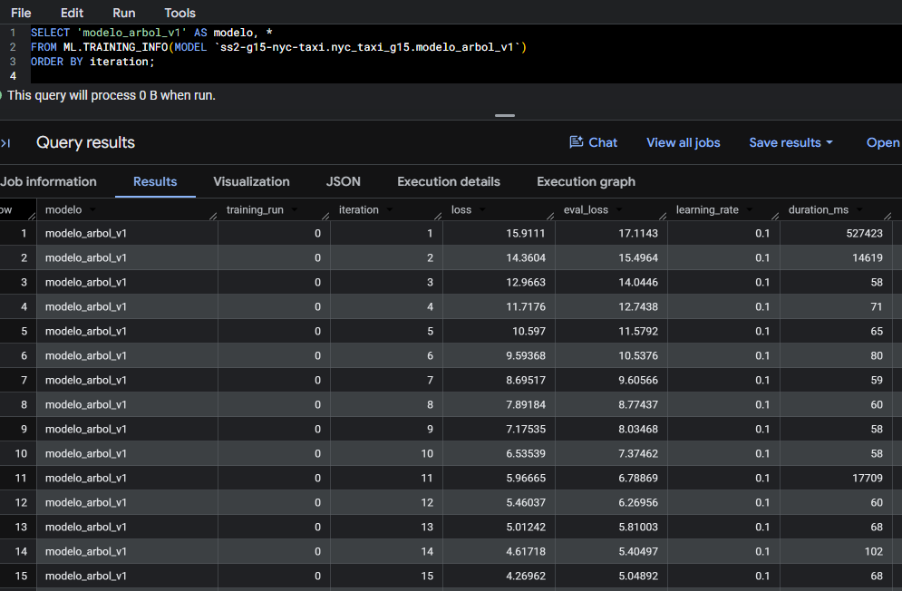
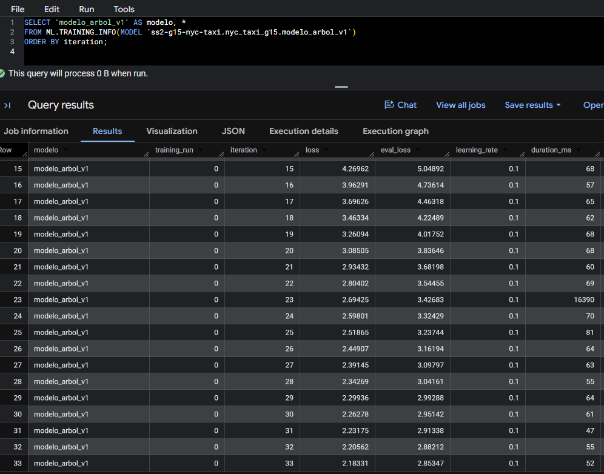
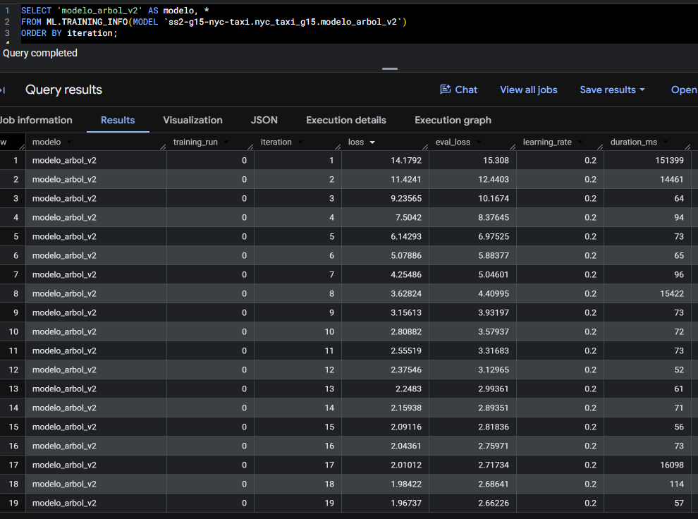

Tabla de predicciones con tarifa real y predicha:

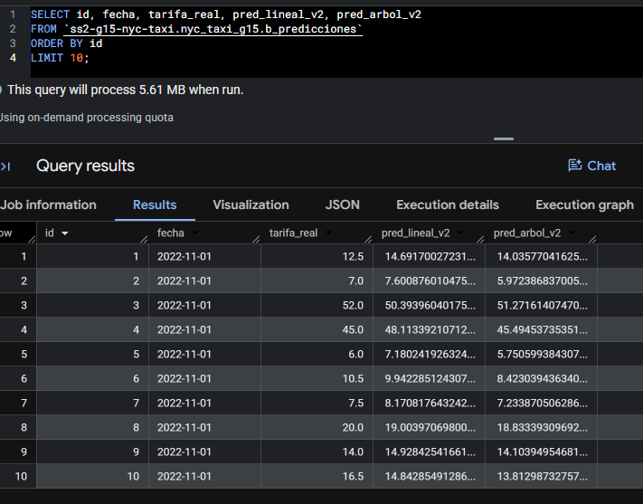

## Informe visual

Tablero en Looker Studio, conectado a BigQuery: https://lookerstudio.google.com/reporting/ab446e94-9f4f-4c79-9f0e-c943b9641a59

- **Exploración:** viajes por día con promedio móvil de 7 días, mapa de calor de viajes por hora y día de la semana, tipo de pago por mes y las 12 zonas con más viajes.
- **Optimización:** MB procesados por las cuatro consultas en la tabla pública, sin optimizar y optimizada.

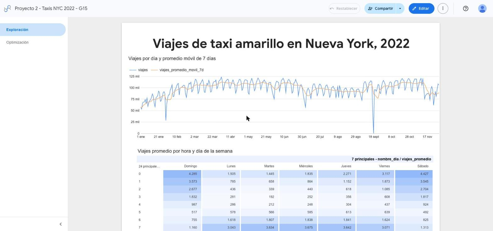
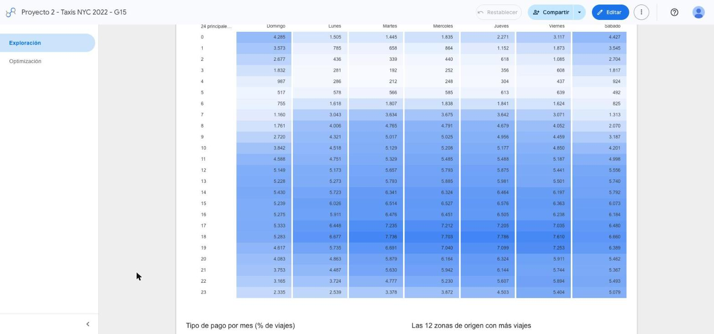
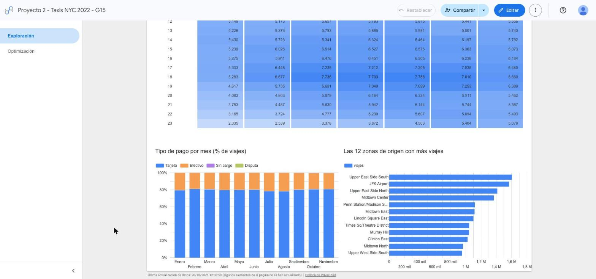
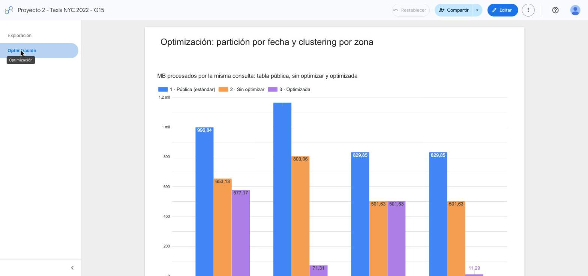

## Evidencias

Conteo de registros del dataset público:

Partición por fecha y clustering de `viajes_limpios` (32,875,149 filas en 334 particiones):

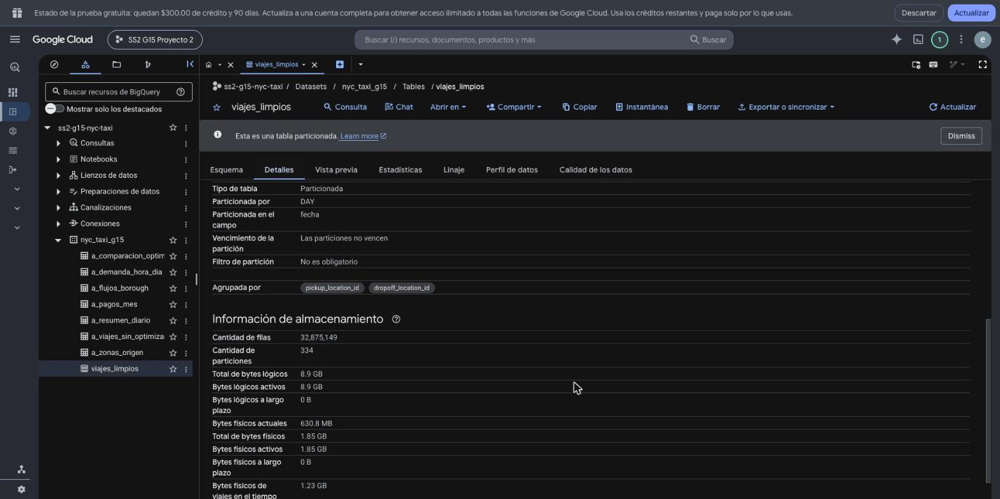

La misma consulta de una semana en la tabla pública (829.85 MB) y en la optimizada (11.29 MB):

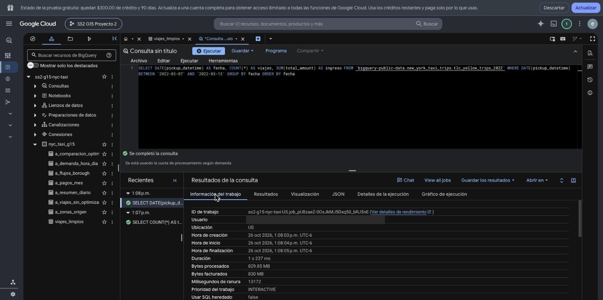
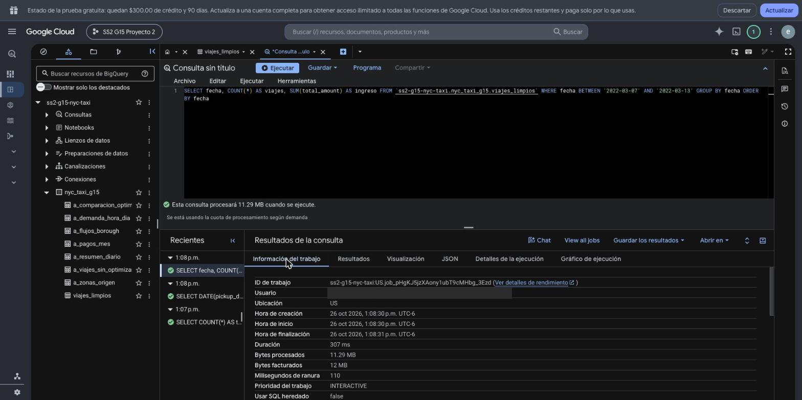

Resultados completos en texto:

- `evidencias/A_resultados_exploracion.txt`: resultados de la exploración.
- `evidencias/A_comparacion_bytes.csv`: bytes procesados y tiempo de cada consulta comparada.
